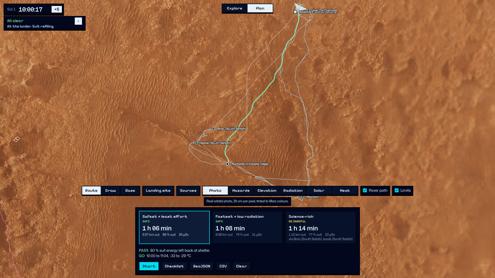
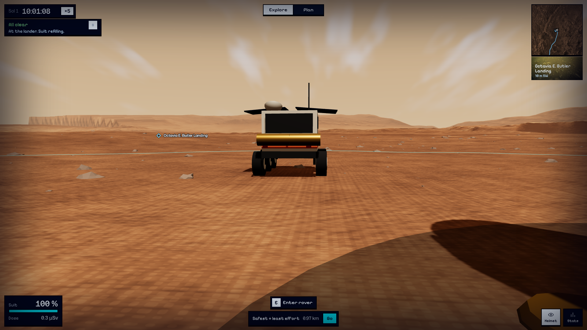
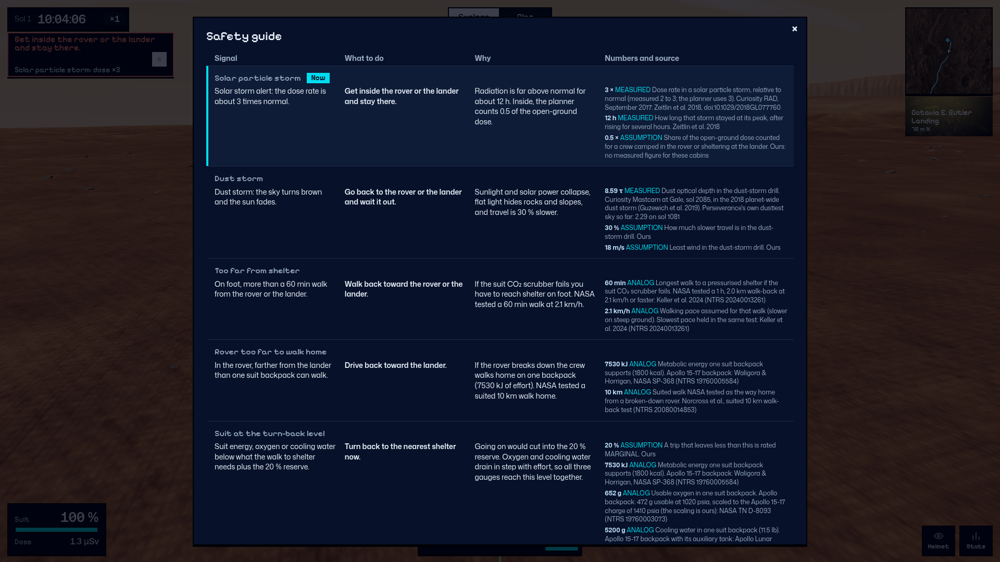
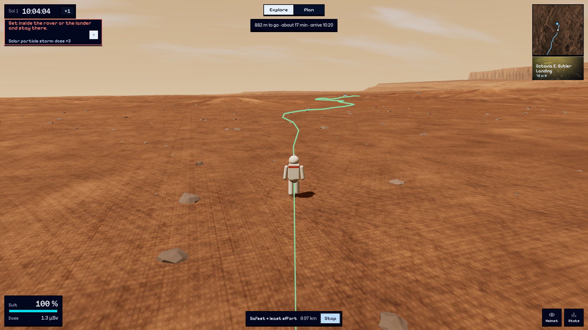

# Mars Base Explorer

**Play it in your browser (no install, no login): https://mohammadalkurd.github.io/NASA-space-app-challenge/**

NASA Space Apps Challenge 2026, challenge "Interplanetary Survival Guide: Martian Map", team **Invincibles**.

| What | Where |
| --- | --- |
| Playable game | https://mohammadalkurd.github.io/NASA-space-app-challenge/ |
| Space Apps project page (summary, team members) | https://www.spaceappschallenge.org/2026/find-a-team/invincibles1/?tab=project |
| Presentation, 7 slides with the 30 second demo on the last slide (PowerPoint, downloads) | [Mars-Base-Explorer-Invincibles.pptx](https://github.com/MohammadAlkurd/NASA-space-app-challenge/releases/download/demo-video/Mars-Base-Explorer-Invincibles.pptx) |
| Demo video, 30 seconds (MP4, downloads) | [mars-base-explorer-demo-30s.mp4](https://github.com/MohammadAlkurd/NASA-space-app-challenge/releases/download/demo-video/mars-base-explorer-demo-30s.mp4) |
| Demo video, 1 minute (MP4, downloads) | [mars-base-explorer-demo-60s.mp4](https://github.com/MohammadAlkurd/NASA-space-app-challenge/releases/download/demo-video/mars-base-explorer-demo-60s.mp4) |
| Every feature, section by section | [docs/features.md](docs/features.md) |
| How it meets each point of the challenge | [docs/challenge-checklist.md](docs/challenge-checklist.md) |
| Every data source and reference, with links | [docs/references.md](docs/references.md) |
| Design notes | [docs/design.md](docs/design.md) |

| Plan: rated routes | Explore: helmet display and crew rover |
| --- | --- |
|  |  |
| **Safety guide (H)** | **Solar storm: what to do now** |
|  |  |

A layered Marswalk planner for Jezero Crater and Gale Crater, built on real NASA data, for the NASA Space Apps Challenge 2026:
**Interplanetary Survival Guide: Martian Map**.

Click anywhere on a 5 km × 5 km piece of Mars and get safe routes for an astronaut on foot or a crew rover, rated
stretch by stretch (Safe / Be careful / Danger / No-go) with the reason. Switch data layers to see why: slopes,
elevation, radiation shelter, heat, radio line of sight to the lander. Walk or drive the route in 3D with a helmet display showing weather, radiation
dose and suit energy. Visit the real science stops of Perseverance (Jezero) or Curiosity (Gale) and see the photo the rover took at each one.

## How it answers the challenge

| The challenge asks for | In this project |
| --- | --- |
| Layered, integrated view of a Martian location from multiple NASA missions | Switchable layers over two landing sites you can walk, Jezero and Gale, from Mars Reconnaissance Orbiter, Mars Odyssey, Mars Global Surveyor, Curiosity and Perseverance |
| At least three kinds of data | Optical (HiRISE), topographic (HiRISE/MOLA), thermal (THEMIS), atmospheric (MEDA), radiation (RAD, DONKI) |
| Astronaut safety, radiation and space weather | A "What to do now" card and a safety guide (press H) with the action, the reason and the sourced number for each hazard; dose rate and trip dose, shelter layer, low-radiation route, DONKI solar-storm status, suit-time budget, slope limits. Solar storms, dust storms and dust devils arrive on their own as the Mars clock runs, at measured rates (Stats > Real odds, or ×100 for a demo); the storm drills force one |
| Suit mobility, route planning around obstacles | Separate limits for astronaut and rover; A* planner avoids no-go slopes; every risky stretch is explained |
| Route map to science objectives | Real Perseverance and Curiosity science stops; the Science-rich route visits those on the way |
| Point-of-view imagery from surface missions | The rover's own Navcam photo at each stop, with credit and link |
| Habitat planning display or helmet HUD | Map view (planning table) and ground view (helmet display with guidance) |
| Robotic support | Crew-rover mode with battery budget; the real Perseverance or Curiosity traverse as a layer |

Full checklist: [docs/challenge-checklist.md](docs/challenge-checklist.md).

## Run it

```bash
npm install
npm run dev        # http://127.0.0.1:5188
npm run build      # production build in dist/
npm test           # Playwright end-to-end test (first time: npx playwright install chromium)
```

Controls: click the ground to plan a route, **Go** to follow it. `W A S D` / arrows to move by hand, drag to look,
wheel to zoom, `M` map view, `C` helmet view, `E` enter or leave the rover, `F` lights, `V` site info inside a site circle, `H` safety guide, `Esc` pause and stats (with the way back to the landing sites).

## Deploy (GitHub Pages)

`.github/workflows/deploy.yml` builds and publishes on every push to `main` (and daily, to refresh the space-weather
snapshot). One-time setup: repository **Settings → Pages → Source: GitHub Actions**. Optional: add a repository
secret `NASA_API_KEY` (free at api.nasa.gov) to avoid the shared `DEMO_KEY` rate limit.

All map data is pre-processed and committed under `public/data/`, so the build needs no NASA downloads.

## Data and credits

| Layer | Source | Credit |
| --- | --- | --- |
| Terrain shape, slopes | HiRISE DTM mosaics, 1 m. Jezero: Mars 2020 TRN mosaic. Gale: MSL Gale merged DEM | USGS Astrogeology / NASA / JPL-Caltech / University of Arizona |
| Ground photo | HiRISE orthomosaics, 25 cm, from the same two products (1.25 m per pixel for the whole site, full 25 cm tiles within about 100 m of the traveller) | same |
| Heat | THEMIS daytime IR global mosaic, 100 m | NASA / JPL-Caltech / Arizona State University / USGS |
| Weather | One measured sol per site. Jezero: MEDA on Perseverance, sol 200. Gale: REMS on Curiosity, sol 196 | NASA PDS Atmospheres Node, Rodriguez-Manfredi et al.; Gomez-Elvira et al. |
| Dust in the air | Optical depth from the rover mast cameras. Jezero: Mastcam-Z, sol 200. Gale: Mastcam, sol 198 | M. Lemmon (Mendeley Data); Lemmon et al., NASA PDS Atmospheres Node |
| Radiation | RAD surface dose 0.67 mSv/day; Murray Buttes shielding | Hassler et al. 2014; Ehresmann et al. 2021 (MSL/RAD) |
| Space weather | DONKI SEP and CME lists | NASA CCMC |
| Science stops, traverse, photos | Mars 2020 and Curiosity mission maps and raw image archives | NASA/JPL-Caltech |
| Crew rover and astronaut models | Space Exploration Vehicle and Mark III Spacesuit, NASA 3D Resources (github.com/nasa/NASA-3D-Resources), reduced and with the logo removed | NASA |

The links for every row, and the papers behind the storm rates, are in [docs/references.md](docs/references.md).
Measured vs. estimated values and model limits are listed in the in-app **Sources** panel (`src/ui/about.ts`).
NASA does not endorse this project. No NASA logos are used.

## Rebuilding the data

```bash
python -m venv .venv && . .venv/bin/activate
pip install -r pipeline/requirements.txt
python pipeline/build_site.py jezero       # terrain + photo (reads the USGS GeoTIFFs over HTTP); or gale
python pipeline/build_mission.py jezero    # science stops, photos, weather, heat layer; or gale
```

The two models in `public/models/` are built from the NASA 3D Resources GLB files:

```bash
cd pipeline/models && npm install
base="https://raw.githubusercontent.com/nasa/NASA-3D-Resources/master/3D%20Models"
curl -L -o sev.glb "$base/Space%20Exploration%20Vehicle/Space%20Exploration%20Vehicle.glb"
curl -L -o suit.glb "$base/Mark%20III%20Spacesuit/Mark%20III%20Spacesuit.glb"
node build_rover.mjs sev.glb ../../public/models/rover.glb
node build_suit.mjs suit.glb ../../public/models/astronaut.glb
```

## Project layout

- `src/world` terrain, sky, markers, rocks · `src/planning` terrain analysis, route planner, base-site scoring
- `src/data` weather and space weather · `src/entities` astronaut, rover · `src/ui` panels · `src/game` wiring
- `pipeline/` Python data preparation · `public/data/` processed NASA data · `src/entities/Rover.ts` the pressurised crew rover, built in code

## Tools and AI use

three.js, TypeScript, Vite, Playwright; Python with rasterio, NumPy, SciPy, Pillow; GitHub Actions and GitHub Pages.

Devin (Cognition AI), an AI coding assistant, helped write and test the code, process the NASA data files and draft
the documentation and the submission text. The team directed the work and reviewed the result.
The game contains no AI-generated images, video, audio or 3D models.
